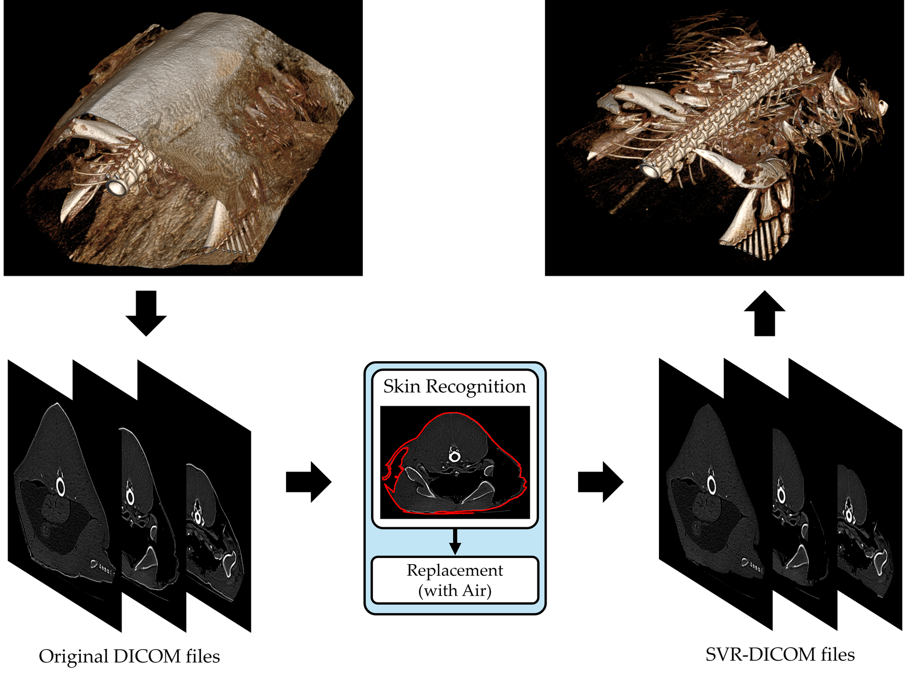
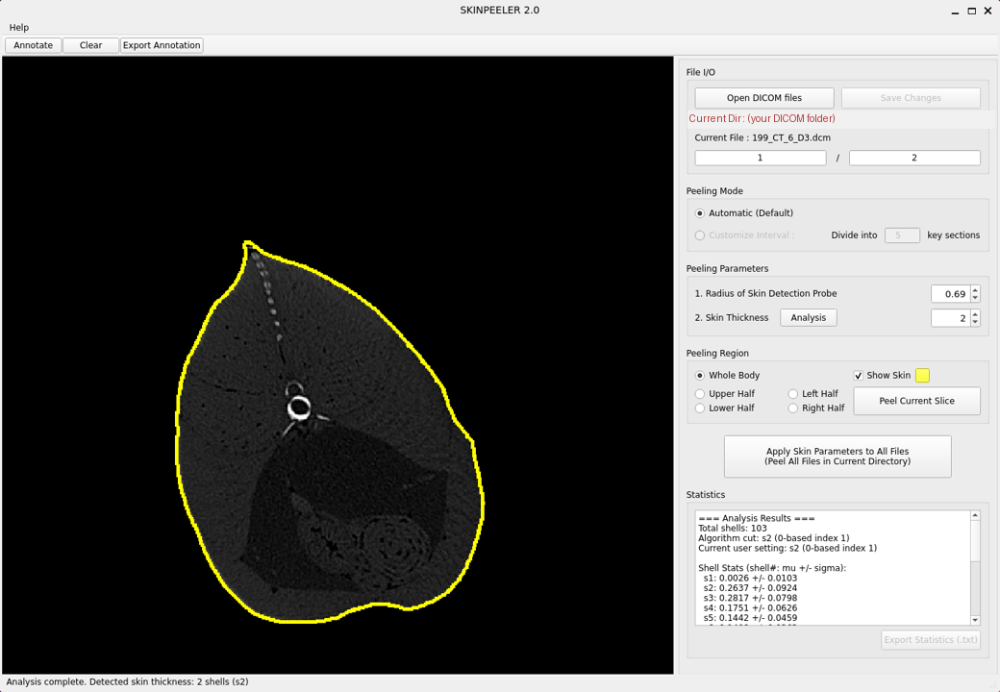
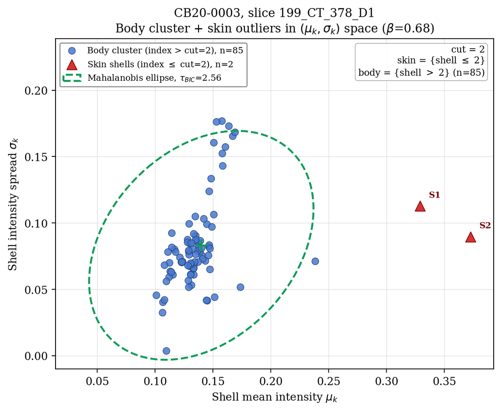
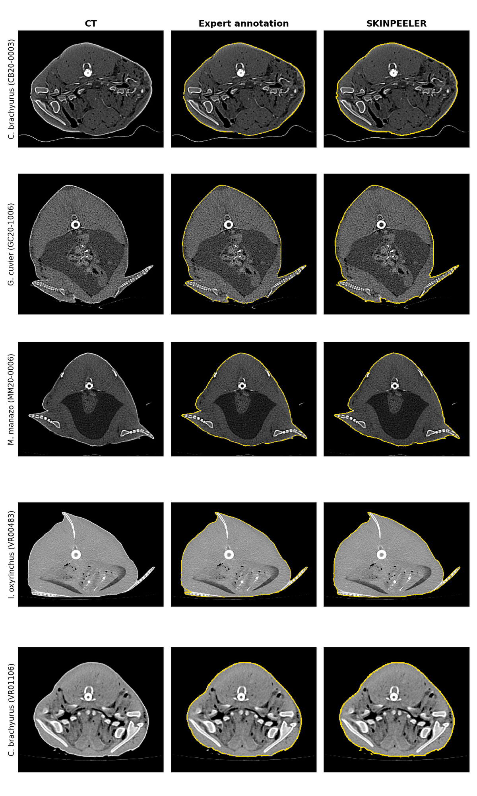
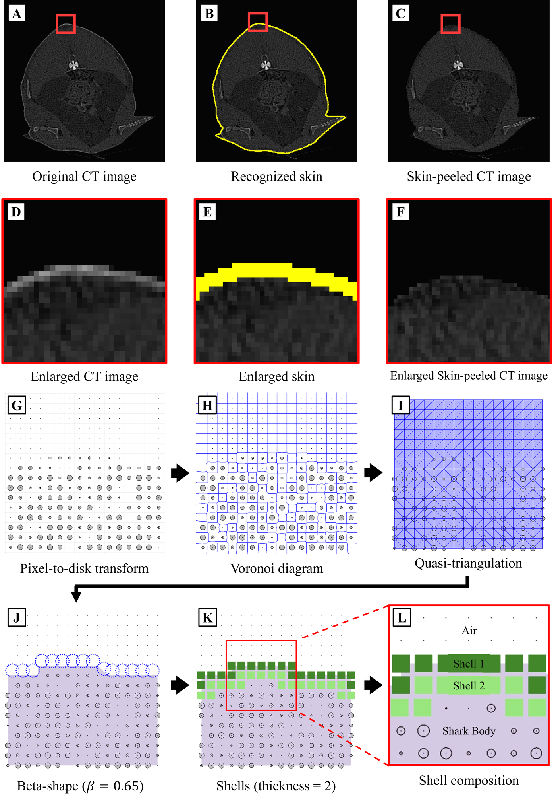
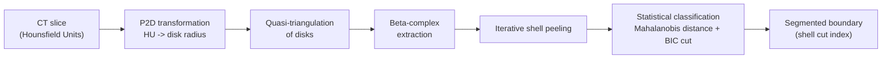
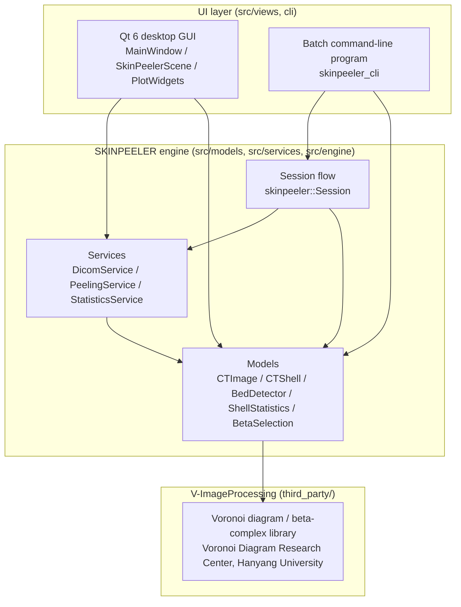
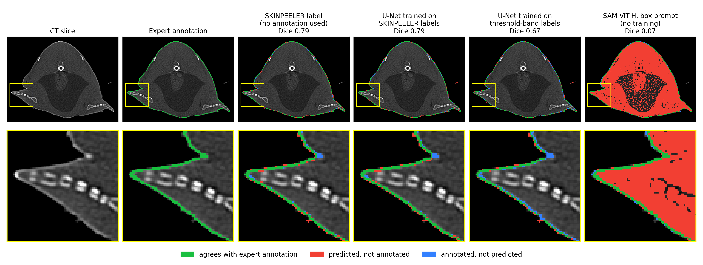
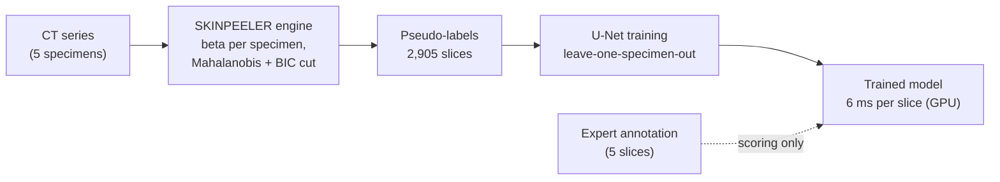
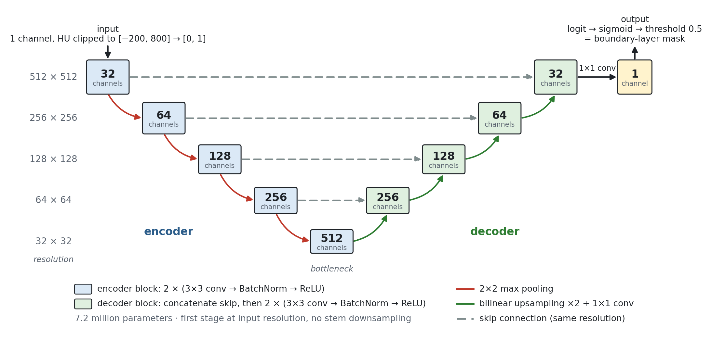

# SKINPEELER

**Voronoi diagram–based boundary segmentation for biological CT, as a C++17 / Qt desktop application.**

[](https://github.com/SKINPEELER-software/SKINPEELER/actions/workflows/ci.yml)




*Left: the dermal denticle (skin) layer hides the internal anatomy. Right: the
same volume after SKINPEELER removes the layer slice by slice. Adapted from
Kim et al., Scientific Reports 15, 19659 (2025), CC BY 4.0.*

<!-- Optional demo GIF (capture pending): open DICOM -> shell overlay ->
adjust beta -> Peel All with progress bar -> save. Place at
assets/screenshots/demo.gif and embed here. -->

SKINPEELER segments the high-density outer boundary of a biological specimen
(e.g. a dermal denticle / skin layer) out of a CT slice series, using an
iterative Voronoi-diagram shell-peeling algorithm. The engine is a
standalone C++17 library; this repository wraps it in a Qt 6 desktop GUI for
interactive use.

## Download

Most users just want to run the application — grab a prebuilt package from
the **[v2.0 release](https://github.com/SKINPEELER-software/SKINPEELER/releases/tag/v2.0)**:
a Windows x86_64 zip (extract and run `SKINPEELER.exe`, no installation
required) or a Linux x86_64 tar.gz (requires the Qt 6 and DCMTK runtime
libraries).

The v2.0 binaries are built with the 3-sigma cut rule. The default cut rule
of the source tree is the Mahalanobis distance + BIC changepoint rule (see
[`docs/algorithm.md`](docs/algorithm.md)).

After downloading, see [`Manual.md`](Manual.md) for how to use the
application.

If you want to build from source (Linux, or Windows via source), or modify
the code, continue reading below.

## Research

SKINPEELER implements a peer-reviewed segmentation algorithm:

- Kim, S. W., Yuen, A. H. L., Kim, H. W., et al. (2025). *Digital removal of
  dermal denticle layer using geometric AI from 3D CT scans of shark
  craniofacial structures enhances anatomical precision.* **Scientific
  Reports**, 15, 19659.
  [https://doi.org/10.1038/s41598-025-04442-1](https://doi.org/10.1038/s41598-025-04442-1)
- Kim, H. W. (2026). *Intelligent Segmentation of High-Density Boundaries in
  Biological CT Data Using Voronoi Diagrams.* Ph.D. dissertation, Hanyang
  University.

The method has been validated across multiple shark species in the
companion publication above. See [`docs/algorithm.md`](docs/algorithm.md)
for a description of the pipeline and parameters.


## Features

- Load a directory of DICOM slices (including JPEG Lossless–compressed
  series) with Hounsfield-Unit windowing applied on load
- Per-slice quasi-triangulation / beta-complex shell computation, with an
  adjustable beta ("detection probe") parameter shared by all slices of
  the loaded series
- Shell overlay visualization on top of the CT slice
- Single-slice or whole-volume ("Peel All") skin removal, with a progress
  bar and cancel support for the batch operation
- Selectable peel region: whole body or a half-body quadrant
- Statistical plots per slice: pixel-intensity Gaussian fit, shell
  (mu, sigma) scatter with the Mahalanobis threshold ellipse of the cut
  rule, and an inter-shell distance histogram
- Manual annotation mode (paint / clear / export a ground-truth skin mask)
  for comparing the algorithm's cut against a hand-drawn reference
- Export of the peeled DICOM series and a per-slice statistics report
- Batch command-line program (`skinpeeler_cli`): per-slice shell statistics
  and skin cut for one or many beta values, air-excluded skin masks,
  per-specimen beta selection, and whole-series peeling — see
  [Command-line program](#command-line-program)

| Desktop GUI | Shell statistics |
|---|---|
|  |  |

Validation against expert annotations across five shark species:



## Algorithm



*End-to-end view of the method on one slice (A–L). Adapted from Kim et al.,
Scientific Reports 15, 19659 (2025), CC BY 4.0.*

SKINPEELER segments the high-density boundary of a slice in five stages:
**P2D transformation** maps each pixel's Hounsfield Unit value to a disk
radius; the **quasi-triangulation of the resulting disks** (the dual of
their Voronoi diagram) is constructed directly on the pixel grid; a
**beta-complex** is extracted from the quasi-triangulation at the
specimen's beta value; **iterative shell peeling** walks
inward from the outer boundary of the beta-complex, extracting concentric
shells; and **statistical classification** (Mahalanobis distance with a
BIC changepoint threshold) determines how many of the outermost shells form
the high-density boundary layer. See [`docs/algorithm.md`](docs/algorithm.md)
for the per-stage input/output and parameter details.



## Architecture

The codebase is split into three layers; the GUI only calls into the
engine and never performs algorithmic computation itself. See
[`docs/architecture.md`](docs/architecture.md) for class-level detail and
the concurrency model.



The engine layer (`src/models`, `src/services`, `src/engine`) has no Qt
dependency, so the same engine code is reusable from other front ends (e.g.
a web service) without modification. It is also built as a static library
(`skinpeeler_core`) for programs that link the engine.

## Learned model

SKINPEELER needs no training data, which makes it a label generator for
models that do. [`learned-model/`](learned-model/) contains a U-Net trained
only on SKINPEELER outputs — no expert annotation in training, model
selection, or parameter selection — and evaluated against expert annotation
on specimens it had never seen.



*Green: agrees with expert annotation. Red: predicted but not annotated.
Blue: annotated but not predicted.*



| | Dice vs. expert annotation |
| --- | --- |
| U-Net trained on SKINPEELER pseudo-labels | 0.819 |
| SKINPEELER (the label generator) | 0.801 |
| U-Net trained on threshold-band labels | 0.746 |
| U-Net trained on 4 expert-annotated slices | 0.704 |
| SAM / MedSAM / SAM 2.1, zero-shot | ≤ 0.178 |



*The network from input to output. Each encoder stage halves the resolution
with 2×2 max pooling and doubles the channels; each decoder stage upsamples
bilinearly, concatenates the encoder feature map of the same resolution
(skip connection), and applies two 3×3 convolutions. A 1×1 convolution
produces the boundary-layer mask.*

**Model.** Encoder–decoder U-Net written from scratch in PyTorch: 5 encoder
stages with 32 base channels (32-64-128-256-512), two 3×3 convolutions with
BatchNorm and ReLU per stage, bilinear upsampling in the decoder, and skip
connections. The first stage works at input resolution, so the
full-resolution skip connection carries the 1–3 pixel wide boundary layer to
the decoder. 7.2 million parameters, trained from scratch with binary
cross-entropy + Dice loss (AdamW, OneCycleLR, mixed precision).

The model reaches the level of its label generator and runs about 170 times
faster (6 ms vs. about 1.1 s per 512 × 512 slice, GPU vs. one CPU process).
Pretrained encoders (ResNet34, SegFormer MiT-B2), nnU-Net and a fine-tuned
MedSAM mask decoder were trained on the same labels for comparison. The
full results, hyperparameter tuning, training code, inference script and
weights are in [`learned-model/`](learned-model/).

## Quick start

### Dependencies

**Ubuntu / Debian:**

```bash
sudo apt install qt6-base-dev libdcmtk-dev
```

(Qt 5 >= 5.13 is also supported as a fallback if Qt 6 is not found.)

**Windows (MSVC x64):** Qt 6 and DCMTK (e.g. through vcpkg). A prebuilt
`V_2D.lib` for V-ImageProcessing is bundled. The bundled Windows library
does not contain the shell-front traversal functions that the batch
command-line program requires, so on Windows `skinpeeler_cli` and its smoke
tests are not built; the GUI, the experiment tools, and the unit tests build
and run. See
[`third_party/v_imageprocessing/NOTICE.md`](third_party/v_imageprocessing/NOTICE.md).

### Build

```bash
cmake -B build
cmake --build build -j$(nproc)
```

By default, CMake links the prebuilt V-ImageProcessing static library
bundled under `third_party/v_imageprocessing/`. See `CMakeLists.txt` for
the lab-internal `-DV_IP_SOURCE_ROOT=` source-build option.

### Try the bundled phantom sample

A synthetic (non-patient, non-specimen) phantom CT series is bundled under
`sample_data/phantom/` so the GUI can be exercised without any real data:

```bash
./build/SKINPEELER
# File -> Open DICOM Directory -> sample_data/phantom
```

Regenerate it, or produce a different size/slice count, with:

```bash
python3 -m pip install pydicom numpy
python3 tools/make_phantom.py -o sample_data/phantom -n 8
```

See [`sample_data/README.md`](sample_data/README.md) for details on what
the phantom contains.

### Try it on a real CT series

`data/test/` bundles a small real CT slice series alongside the SKINPEELER
output for it, as a worked example:

- `data/test/original/` — 8 input DICOM slices
- `data/test/peeled/` — the corresponding `peeled-*.dcm` output

```bash
./build/SKINPEELER
# File -> Open DICOM Directory -> data/test/original
```

## Command-line program

`skinpeeler_cli` runs the engine on a DICOM series without the GUI. It only
parses arguments and writes files; every value comes from the engine.

```bash
# Per-slice shell statistics and skin cut for beta = 0.60, 0.61, ..., 0.70.
# One slice is in memory at a time; one Voronoi structure per slice serves
# all beta values. --masks also writes the air-excluded skin mask and the
# air mask of every slice and beta as PNG.
./build/skinpeeler_cli shells sample_data/phantom --out out/phantom \
    --beta-range 0.60 0.70 0.01 --masks

# Per-specimen beta from that output, by one rule or by all twelve.
./build/skinpeeler_cli select-beta out/phantom --rule all

# Peel every slice of the series at its skin cut and write the DICOM series.
./build/skinpeeler_cli peel sample_data/phantom --out out/phantom_peeled --beta 0.69
```

| Command | Output |
|---|---|
| `shells` | `slices.csv` (one row per slice and beta: selected component, number of shells, cut, cut rule, BIC threshold, air threshold, mask pixel counts), `shells.csv` (one row per shell: mu, sigma, vertex count, Mahalanobis distance), `manifest.json` (settings, command line, timing), and with `--masks` `masks/b<beta>/<file>_skin.png` and `_air.png` |
| `select-beta` | `beta_selection.csv` / `.json` (selected beta and the per-beta score table), or with `--rule all` one summary plus one table per rule |
| `peel` | `peeled-<file>` DICOM series and `manifest.json` |

`--range START:END` restricts `shells` to a slice range (intensity
normalization still uses the maximum of the full series), so a long series
can be processed in chunks; `select-beta` accepts several output directories
of the same specimen. `skinpeeler_cli --help` lists every option. Exit code
0 means every slice succeeded, 1 that at least one slice failed, 2 a usage
or fatal error. The beta-selection rules are described in
[`docs/algorithm.md`](docs/algorithm.md#selecting-beta-for-a-specimen).

`skinpeeler_cli` is built when the linked V-ImageProcessing library provides
the shell-front traversal functions (the bundled Linux library does; the
bundled Windows library does not — see
[`third_party/v_imageprocessing/NOTICE.md`](third_party/v_imageprocessing/NOTICE.md)).

## Tests & CI

```bash
ctest --test-dir build --output-on-failure
```

68 GoogleTest unit/integration tests cover the pure-math cutting-statistics
module (`ShellStatistics`), the beta-selection rules (`BetaSelection`),
`CTShell` statistics, `BedDetector`'s public static helpers,
`PeelingService`'s section/interpolation math, `StatisticsService`'s
inter-shell distance computation, and engine tests on the bundled phantom
DICOM series: `CTImage::calculateShells()`, the agreement of
`CTImage::sweepBetas()` with a separate calculation at each beta, the shell /
skin / air-excluded masks, and `skinpeeler::Session`. Five CTest smoke tests
run `skinpeeler_cli` (`shells`, `select-beta`, `peel`, `--version`, a usage
error) on the phantom series. GitHub Actions
(`.github/workflows/ci.yml`) runs the full build + CTest suite and a
clang-format compliance check on every push/PR to `main`.

## Repository layout

```
SKINPEELER/
├── CMakeLists.txt
├── Manual.md       # End-user manual (v1.0 executable)
├── src/
│   ├── models/     # Engine: CTImage, CTShell, BedDetector, BedCache, ShellStatistics, BetaSelection
│   ├── services/    # Engine: DicomService, PeelingService, StatisticsService
│   ├── engine/     # Engine: Session (load, calculate, query, peel, save; one-slice-at-a-time series access)
│   ├── views/      # Qt GUI: MainWindow, SkinPeelerScene, PlotWidgets, PlotWindow
│   ├── utils/      # CoordinateTransform
│   └── config/     # Settings.h (algorithm/UI constants)
├── cli/            # skinpeeler_cli (batch command-line program) and standalone experiment tools (no Qt dependency)
├── tests/          # GoogleTest + CTest suite
├── learned-model/   # U-Net trained on SKINPEELER pseudo-labels (PyTorch): model, training, inference
├── sample_data/     # Synthetic phantom DICOM series + generator notes
├── data/test/      # Worked example: a real CT slice series + its SKINPEELER output
├── tools/          # make_phantom.py (phantom generator), rebuild_v_imageprocessing_bundle.sh (lab-internal)
├── third_party/
│   └── v_imageprocessing/  # Prebuilt V-ImageProcessing library + public headers
├── assets/         # App icon, screenshots, demo GIF
└── docs/
    ├── architecture.md
    └── algorithm.md
```

## License & Acknowledgements

The original SKINPEELER source in this repository (`src/`, `cli/`, build
scripts, documentation) is licensed under the [MIT License](LICENSE).

This project links against **V-ImageProcessing**, a computational geometry
library (Voronoi diagram / beta-complex construction) that is proprietary
software owned and developed by the **Voronoi Diagram Research Center
(VDRC), Hanyang University**. Its source is not included here; a prebuilt
binary and public headers are bundled with the research center's
permission so that SKINPEELER can be built end-to-end. See
[`third_party/v_imageprocessing/NOTICE.md`](third_party/v_imageprocessing/NOTICE.md)
for the full terms — this bundle is **not** covered by the MIT license
above.

The bundled sample data (`sample_data/phantom/`) is a procedurally
generated synthetic phantom with no real patient or specimen imaging
content; see [`sample_data/README.md`](sample_data/README.md).
