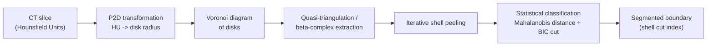
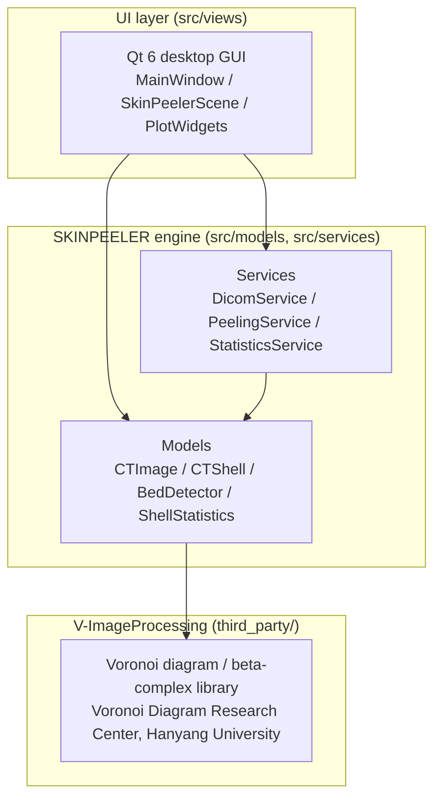

# SKINPEELER

**Voronoi diagram–based boundary segmentation for biological CT, as a C++17 / Qt desktop application.**

[](https://github.com/SKINPEELER-software/SKINPEELER/actions/workflows/ci.yml)


<!--
Demo GIF: capture pending. Record a short clip covering: open a DICOM
directory -> shell overlay appears on the slice -> adjust the beta
("detection probe") value -> run Peel All with the progress bar visible ->
save the peeled series. Place the recording at assets/screenshots/demo.gif.
-->


SKINPEELER segments the high-density outer boundary of a biological specimen
(e.g. a dermal denticle / skin layer) out of a CT slice series, using an
iterative Voronoi-diagram shell-peeling algorithm. The engine is a
standalone C++17 library; this repository wraps it in a Qt 6 desktop GUI for
interactive use.

## Download

Most users just want to run the application — grab the prebuilt Windows
executable from the **[v1.0 release](https://github.com/SKINPEELER-software/SKINPEELER/releases/tag/v1.0)**
(no build step required). A v2.0 release with the current source-tree
feature set (whole-volume "Peel All" with a progress bar and cancel
support, etc.) is planned.

After downloading, see [`Manual.md`](Manual.md) for how to use the
application.

If you want to build from source (Linux, or Windows via source), or modify
the code, continue reading below.

## Research

SKINPEELER implements a peer-reviewed segmentation algorithm:

- Kim, S. W., Yuen, A. H. L., Kim, H. W., et al. (2025). *Digital removal of
  dermal denticle layer using geometric AI from 3D CT scans of shark
  craniofacial structures enhances anatomical precision.* **Scientific
  Reports**, 15, 19659.
  [https://doi.org/10.1038/s41598-025-04442-1](https://doi.org/10.1038/s41598-025-04442-1)
- Kim, H. W. (2026). *Intelligent Segmentation of High-Density Boundaries in
  Biological CT Data Using Voronoi Diagrams.* Ph.D. dissertation, Hanyang
  University.

The method has been validated across multiple shark species in the
companion publication above. See [`docs/algorithm.md`](docs/algorithm.md)
for a description of the pipeline and parameters.

## Features

- Load a directory of DICOM slices (including JPEG Lossless–compressed
  series) with Hounsfield-Unit windowing applied on load
- Per-slice Voronoi diagram / beta-complex shell computation, with an
  adjustable beta ("detection probe") parameter
- Shell overlay visualization on top of the CT slice
- Single-slice or whole-volume ("Peel All") skin removal, with a progress
  bar and cancel support for the batch operation
- Selectable peel region: whole body or a half-body quadrant
- Statistical plots per slice: pixel-intensity Gaussian fit, shell
  (mu, sigma) scatter with a 3-sigma ellipse, and an inter-shell distance
  histogram
- Manual annotation mode (paint / clear / export a ground-truth skin mask)
  for comparing the algorithm's cut against a hand-drawn reference
- Export of the peeled DICOM series and a per-slice statistics report

<!-- Screenshot: main DICOM viewer with a loaded CT slice, before any
     shell overlay or peeling. Save as assets/screenshots/main_viewer.png -->
<!-- Screenshot: same slice with the shell overlay enabled, showing the
     concentric shells extracted from the Voronoi diagram. Save as
     assets/screenshots/shell_overlay.png -->
<!-- Screenshot: the statistics window (Gaussian / scatter / histogram
     plots) for one slice. Save as assets/screenshots/statistics.png -->
<!-- Screenshot: a slice after peeling, showing the high-density boundary
     layer removed. Save as assets/screenshots/peel_result.png -->

| Main viewer | Shell overlay |
|---|---|
|  |  |

| Statistics | Peel result |
|---|---|
|  |  |

## Algorithm

SKINPEELER segments the high-density boundary of a slice in five stages:
**P2D transformation** maps each pixel's Hounsfield Unit value to a disk
radius; a **Voronoi diagram of the resulting disks** is constructed over
the slice; a **quasi-triangulation / beta-complex** is extracted from the
Voronoi diagram at a chosen beta value; **iterative shell peeling** walks
inward from the outer boundary of the beta-complex, extracting concentric
shells; and **statistical classification** (Mahalanobis distance against a
BIC-based decision) determines how many of the outermost shells form the
high-density boundary layer. See [`docs/algorithm.md`](docs/algorithm.md)
for the per-stage input/output and parameter details.



## Architecture

The codebase is split into three layers; the GUI only calls into the
engine and never performs algorithmic computation itself. See
[`docs/architecture.md`](docs/architecture.md) for class-level detail and
the concurrency model.



The engine layer (`src/models`, `src/services`) has no Qt dependency, so the
same engine code is reusable from other front ends (e.g. a web service)
without modification.

## Quick start

### Dependencies

**Ubuntu / Debian:**

```bash
sudo apt install qt6-base-dev libdcmtk-dev
```

(Qt 5 >= 5.13 is also supported as a fallback if Qt 6 is not found.)

**Windows (MSVC):** a prebuilt Windows `V_2D.lib` for V-ImageProcessing is
not yet bundled in this repository — see
[`third_party/v_imageprocessing/NOTICE.md`](third_party/v_imageprocessing/NOTICE.md).
TODO: bundle a Windows prebuilt library once available.

### Build

```bash
cmake -B build
cmake --build build -j$(nproc)
```

By default, CMake links the prebuilt V-ImageProcessing static library
bundled under `third_party/v_imageprocessing/`. See `CMakeLists.txt` for
the lab-internal `-DV_IP_SOURCE_ROOT=` source-build option.

### Try the bundled phantom sample

A synthetic (non-patient, non-specimen) phantom CT series is bundled under
`sample_data/phantom/` so the GUI can be exercised without any real data:

```bash
./build/SKINPEELER
# File -> Open DICOM Directory -> sample_data/phantom
```

Regenerate it, or produce a different size/slice count, with:

```bash
python3 -m pip install pydicom numpy
python3 tools/make_phantom.py -o sample_data/phantom -n 8
```

See [`sample_data/README.md`](sample_data/README.md) for details on what
the phantom contains.

### Try it on a real CT series

`data/test/` bundles a small real CT slice series alongside the SKINPEELER
output for it, as a worked example:

- `data/test/original/` — 8 input DICOM slices
- `data/test/peeled/` — the corresponding `peeled-*.dcm` output

```bash
./build/SKINPEELER
# File -> Open DICOM Directory -> data/test/original
```

## Tests & CI

```bash
ctest --test-dir build --output-on-failure
```

37 GoogleTest unit/integration tests cover the pure-math cutting-statistics
module (`ShellStatistics`), `CTShell` statistics, `BedDetector`'s public
static helpers, `PeelingService`'s section/interpolation math,
`StatisticsService`'s inter-shell distance computation, and one end-to-end
integration test that loads the bundled phantom DICOM slice and runs
`CTImage::calculateShells()`. GitHub Actions
(`.github/workflows/ci.yml`) runs the full build + CTest suite and a
clang-format compliance check on every push/PR to `main`.

## Repository layout

```
SKINPEELER/
├── CMakeLists.txt
├── Manual.md       # End-user manual (v1.0 executable)
├── src/
│   ├── models/     # Engine: CTImage, CTShell, BedDetector, BedCache, ShellStatistics
│   ├── services/    # Engine: DicomService, PeelingService, StatisticsService
│   ├── views/      # Qt GUI: MainWindow, SkinPeelerScene, PlotWidgets, PlotWindow
│   ├── utils/      # CoordinateTransform
│   └── config/     # Settings.h (algorithm/UI constants)
├── cli/            # Standalone experiment CLI tools (no Qt dependency)
├── tests/          # GoogleTest + CTest suite
├── sample_data/     # Synthetic phantom DICOM series + generator notes
├── data/test/      # Worked example: a real CT slice series + its SKINPEELER output
├── tools/          # make_phantom.py (phantom generator)
├── third_party/
│   └── v_imageprocessing/  # Prebuilt V-ImageProcessing library + public headers
├── assets/         # App icon, screenshots, demo GIF
└── docs/
    ├── architecture.md
    └── algorithm.md
```

## License & Acknowledgements

The original SKINPEELER source in this repository (`src/`, `cli/`, build
scripts, documentation) is licensed under the [MIT License](LICENSE).

This project links against **V-ImageProcessing**, a computational geometry
library (Voronoi diagram / beta-complex construction) that is proprietary
software owned and developed by the **Voronoi Diagram Research Center
(VDRC), Hanyang University**. Its source is not included here; a prebuilt
binary and public headers are bundled with the research center's
permission so that SKINPEELER can be built end-to-end. See
[`third_party/v_imageprocessing/NOTICE.md`](third_party/v_imageprocessing/NOTICE.md)
for the full terms — this bundle is **not** covered by the MIT license
above.

The bundled sample data (`sample_data/phantom/`) is a procedurally
generated synthetic phantom with no real patient or specimen imaging
content; see [`sample_data/README.md`](sample_data/README.md).
