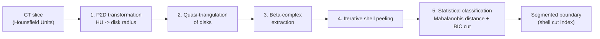

# Algorithm

SKINPEELER segments the high-density outer boundary of a biological
specimen (e.g. a dermal denticle / skin layer) from a CT slice in five
stages. The method is described and validated in:

- Kim, S. W., Yuen, A. H. L., Kim, H. W., et al. (2025). *Digital removal of
  dermal denticle layer using geometric AI from 3D CT scans of shark
  craniofacial structures enhances anatomical precision.* **Scientific
  Reports**, 15, 19659.
  [https://doi.org/10.1038/s41598-025-04442-1](https://doi.org/10.1038/s41598-025-04442-1)
- Kim, H. W. (2026). *Intelligent Segmentation of High-Density Boundaries in
  Biological CT Data Using Voronoi Diagrams.* Ph.D. dissertation, Hanyang
  University.

This document summarizes the five stages as implemented in this codebase
(`src/models/CTImage.cpp`, `src/models/BedDetector.cpp`,
`src/models/ShellStatistics.cpp`). It does not restate experimental results
from the papers above — see the papers for validation figures and
quantitative performance.

## 1. P2D transformation

**Input:** a CT slice as a 2D array of Hounsfield Unit (HU) values (one
value per pixel), read from DICOM pixel data after applying the DICOM
rescale slope/intercept and VOI LUT windowing.

**Output:** one disk per pixel, each disk centered at the pixel's image
coordinate with a radius derived from that pixel's HU value — denser
tissue (higher HU) maps to a larger disk. This is the "P2D" (pixel-to-disk)
step that turns a raster image into the point/weight input the
quasi-triangulation construction expects.

## 2. Quasi-triangulation of disks

**Input:** the full set of weighted disks from stage 1.

**Output:** the quasi-triangulation of those disks — the dual structure of
their additively-weighted Voronoi diagram — built by V-ImageProcessing
(`ImageProcessingBC::constructForImageProcessing16bit` in this codebase).
Because the disk centers lie on the regular pixel grid, the
quasi-triangulation is constructed directly on that grid; the Voronoi
diagram itself is not computed. Each quasi-triangulation vertex corresponds
to one disk, and an edge joins two disks whose Voronoi cells are adjacent.

## 3. Beta-complex extraction

**Input:** the quasi-triangulation from stage 2 and a scalar **beta**
parameter.

**Output:** the beta-complex (a subset of the quasi-triangulation) at that
beta value, and its connected components. The
implementation classifies components by score (`area * circularity^2`) and
selects the highest-scoring component as the body ("body0") — the
component that best represents the specimen's connected tissue mass as
opposed to background, imaging artifacts, or (if present) the scan bed.
`BedDetector` runs on these components to identify and exclude CT-bed
components from that selection when bed removal is enabled.

Beta controls how permissive the complex is in connecting nearby disks.
Beta is a specimen-level parameter: one value is used for every slice of a
specimen's CT series. `DEFAULT_BETA` in `src/config/Settings.h` is the
starting value, and the GUI's "detection probe" control changes it for the
loaded series. See the papers above for how beta is chosen/validated for a
given specimen.

## 4. Iterative shell peeling

**Input:** the beta-complex's selected (body) component from stage 3.

**Output:** a sequence of concentric **shells**, numbered outward-in
starting from 0 (the outermost boundary). Each shell is extracted by
repeatedly peeling the outer boundary of the remaining structure and
recording the removed layer's vertices (disk position + radius).
Each shell's set of disk radii (equivalently, diameters) is summarized by
its mean and standard deviation (`CTShell::calculateStatistics()`,
population standard deviation). This produces a per-shell `(mu, sigma)`
sequence describing how local tissue density/thickness changes moving
inward from the surface.

## 5. Statistical classification (cut decision)

**Input:** the per-shell `(mu, sigma)` sequence from stage 4.

**Output:** a single integer **cut index** `c`. Shells `0 .. c` form the
high-density boundary layer (e.g. the dermal denticle / skin layer) and are
removed by peeling; shells `c+1 ..` are interior tissue. Shell 0, the
outermost layer in contact with air, is excluded from the statistics, and
shell 1 is always part of the boundary layer, so `c >= 1`.

The default classifier (`ShellStatistics::cuttingMahalBic`,
`CuttingAlgorithm::MAHAL_BIC` in `src/config/Settings.h`) is a Mahalanobis
distance + Bayesian information criterion (BIC) changepoint rule over the
shells `S1 .. Sm` (shell 1 to the innermost shell):

1. **Gaussian fit.** A 2D Gaussian (mean and sample covariance) is fitted
   to the `(mu, sigma)` points of `S2 .. Sm`. `S1` is excluded from the fit.
2. **Mahalanobis distance.** Each shell's Mahalanobis distance `d` to that
   fit is computed. Boundary-layer shells lie far from the interior-tissue
   cluster and have large `d`.
3. **BIC changepoint.** On the outside-in sequence of squared distances
   `d^2` of `S2 .. Sm`, a single-Gaussian model (2 parameters) is compared
   with the best two-segment model with separate mean and variance per
   segment (4 parameters), using `BIC = -2 ln L + p ln m`. A changepoint is
   selected when the two-segment model has the lower BIC.
4. **Threshold and cut.** The threshold `tau` is the square root of the
   mean of the two `d^2` values on either side of the changepoint. The
   first shell from `S2` inward with `d <= tau` is the first interior shell,
   and the cut index is the index of the shell before it.

The rule has no tuned threshold: `tau` is derived from each slice's own
shell sequence. If BIC selects no changepoint, every shell is classified as
boundary layer (the cut index is the last shell). If fewer than four shells
carry statistics, the cut falls back to a Euclidean distance-jump heuristic
(`ShellStatistics::cuttingEuclideanDistance`): the largest consecutive jump
in `(mu, sigma)` space.

The rule is selected at compile time by `DEFAULT_CUTTING_ALGORITHM` in
`src/config/Settings.h`. The alternatives are:

- `CuttingAlgorithm::THREE_SIGMA` (`ShellStatistics::cutting3SigmaDistance`)
  — fits the Gaussian over all of `S1 .. Sm` and classifies shells inside a
  fixed Mahalanobis ellipse (`SIGMA_THRESHOLD` = 3.0) as interior; when
  `S1` is already inside the ellipse or no shell is, the cut comes from a
  distribution-free jump detection (`findDistanceJump`, threshold
  `DISTANCE_JUMP_SIGMA` = 2.0).
- `CuttingAlgorithm::EUCLIDEAN` — the Euclidean distance-jump heuristic
  alone.
- `CuttingAlgorithm::GMM` — declared but not implemented; it runs the
  Euclidean heuristic.

This is a pure-math module (`src/models/ShellStatistics.*`) with no
dependency on `CTImage`, V-ImageProcessing, or DCMTK, so the cut-decision
logic is unit-tested directly against synthetic `(mu, sigma)` inputs (see
`tests/test_shell_statistics.cpp`).

## Parameters at a glance

| Parameter | Meaning | Default (`src/config/Settings.h`) |
|---|---|---|
| `beta` | Beta-complex construction parameter (stage 3); controls how permissively nearby disks are connected into the body component. One value per specimen (CT series). | `DEFAULT_BETA = 0.7` |
| cut index | Index of the innermost shell (stage 5) classified as the high-density boundary layer. | computed per slice, not a fixed constant |
| `DEFAULT_CUTTING_ALGORITHM` | Cut rule used in stage 5. | `CuttingAlgorithm::MAHAL_BIC` |
| `SIGMA_THRESHOLD` | Mahalanobis-distance ellipse threshold (in sigma). Used only by the `THREE_SIGMA` rule. | `3.0` |
| `DISTANCE_JUMP_SIGMA` | Threshold (in sigma of inter-shell distances) for jump detection. Used only by the `THREE_SIGMA` rule. | `2.0` |

See the papers listed above for how these parameters were chosen and
validated against ground truth on real specimen CT data.
