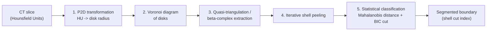

# Algorithm

SKINPEELER segments the high-density outer boundary of a biological
specimen (e.g. a dermal denticle / skin layer) from a CT slice in five
stages. The method is described and validated in:

- Kim, S. W., Yuen, A. H. L., Kim, H. W., et al. (2025). *Digital removal of
  dermal denticle layer using geometric AI from 3D CT scans of shark
  craniofacial structures enhances anatomical precision.* **Scientific
  Reports**, 15, 19659.
  [https://doi.org/10.1038/s41598-025-04442-1](https://doi.org/10.1038/s41598-025-04442-1)
- Kim, H. W. (2026). *Intelligent Segmentation of High-Density Boundaries in
  Biological CT Data Using Voronoi Diagrams.* Ph.D. dissertation, Hanyang
  University.

This document summarizes the five stages as implemented in this codebase
(`src/models/CTImage.cpp`, `src/models/BedDetector.cpp`,
`src/models/ShellStatistics.cpp`). It does not restate experimental results
from the papers above — see the papers for validation figures and
quantitative performance.

## 1. P2D transformation

**Input:** a CT slice as a 2D array of Hounsfield Unit (HU) values (one
value per pixel), read from DICOM pixel data after applying the DICOM
rescale slope/intercept and VOI LUT windowing.

**Output:** one disk per pixel, each disk centered at the pixel's image
coordinate with a radius derived from that pixel's HU value — denser
tissue (higher HU) maps to a larger disk. This is the "P2D" (pixel-to-disk)
step that turns a raster image into the point/weight input the Voronoi
construction expects.

## 2. Voronoi diagram of disks

**Input:** the full set of weighted disks from stage 1.

**Output:** the additively-weighted Voronoi diagram of those disks,
constructed by V-ImageProcessing (`ImageProcessingBC::constructForImageProcessing16bit`
in this codebase). Each Voronoi cell corresponds to one disk's region of
influence; neighboring cells that correspond to touching/overlapping disks
indicate adjacent tissue.

## 3. Quasi-triangulation / beta-complex extraction

**Input:** the Voronoi diagram from stage 2 and a scalar **beta**
parameter.

**Output:** the beta-complex (a subset of the quasi-triangulation dual to
the Voronoi diagram) at that beta value, and its connected components. The
implementation classifies components by score (`area * circularity^2`) and
selects the highest-scoring component as the body ("body0") — the
component that best represents the specimen's connected tissue mass as
opposed to background, imaging artifacts, or (if present) the scan bed.
`BedDetector` runs on these components to identify and exclude CT-bed
components from that selection when bed removal is enabled.

Beta controls how permissive the complex is in connecting nearby disks: in
this codebase, a specimen- and dataset-dependent beta is set per slice (see
`DEFAULT_BETA` in `src/config/Settings.h`) and can be adjusted interactively
in the GUI (the "detection probe" control). See the papers above for how
beta is chosen/validated for a given specimen.

## 4. Iterative shell peeling

**Input:** the beta-complex's selected (body) component from stage 3.

**Output:** a sequence of concentric **shells**, numbered outward-in
starting from 0 (the outermost boundary). Each shell is extracted by
repeatedly peeling the outer boundary of the remaining structure and
recording the removed layer's Voronoi vertices (position + disk radius).
Each shell's set of disk radii (equivalently, diameters) is summarized by
its mean and standard deviation (`CTShell::calculateStatistics()`,
population standard deviation). This produces a per-shell `(mu, sigma)`
sequence describing how local tissue density/thickness changes moving
inward from the surface.

## 5. Statistical classification (cut decision)

**Input:** the per-shell `(mu, sigma)` sequence from stage 4.

**Output:** a single integer **cut index**: the number of outermost shells
classified as the high-density boundary layer (e.g. the dermal denticle /
skin layer), as opposed to interior tissue. Shells at index `0 .. cut-1` are
the boundary layer; the rest are interior.

The default classifier (`ShellStatistics::cutting3SigmaDistance`,
`CuttingAlgorithm::THREE_SIGMA` in `src/config/Settings.h`) fits a 2D
Gaussian over the `(mu, sigma)` points, computes each shell's Mahalanobis
distance to that fit, and walks inward from the outermost shell: shells
within a sigma-threshold ellipse (`SIGMA_THRESHOLD` = 3.0 by default) are
classified as interior, and the cut is placed at the first such shell
(minus one). If fewer than four shells are available or the fitted
covariance is singular, the implementation falls back to a Euclidean
distance-jump heuristic (`ShellStatistics::cuttingEuclideanDistance`): the
largest consecutive jump in `(mu, sigma)` space. A distribution-free
jump-detection fallback (`findDistanceJump`, threshold
`DISTANCE_JUMP_SIGMA` = 2.0 by default) is also available. A Gaussian
Mixture Model variant (`CuttingAlgorithm::GMM`) is declared but not yet
implemented and currently falls back to the Euclidean heuristic.

This is a pure-math module (`src/models/ShellStatistics.*`) with no
dependency on `CTImage`, V-ImageProcessing, or DCMTK, so the cut-decision
logic is unit-tested directly against synthetic `(mu, sigma)` inputs (see
`tests/test_shell_statistics.cpp`).

## Parameters at a glance

| Parameter | Meaning | Default (`src/config/Settings.h`) |
|---|---|---|
| `beta` | Beta-complex construction parameter (stage 3); controls how permissively nearby disks are connected into the body component. | `DEFAULT_BETA = 0.7` |
| cut index | Number of outermost shells (stage 5) classified as the high-density boundary layer. | computed per slice, not a fixed constant |
| `SIGMA_THRESHOLD` | Mahalanobis-distance ellipse threshold (in sigma) used by the default 3-sigma classifier to decide "inside" vs. boundary. | `3.0` |
| `DISTANCE_JUMP_SIGMA` | Threshold (in sigma of inter-shell distances) for the distribution-free jump-detection fallback. | `2.0` |

See the papers listed above for how these parameters were chosen and
validated against ground truth on real specimen CT data.
