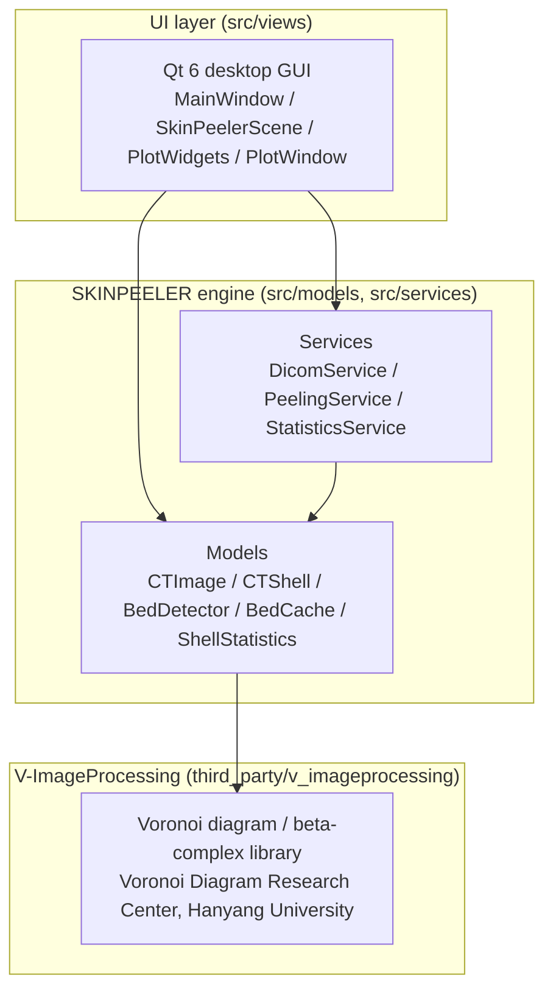

# Architecture

SKINPEELER is organized into three layers. Each layer only calls downward;
algorithmic logic lives in the engine layer, never in the UI layer.

## Layers

1. **V-ImageProcessing** (`third_party/v_imageprocessing/`) — a prebuilt,
   proprietary computational geometry library (Voronoi diagram / beta-complex
   construction, exposed to this project through `ImageProcessingBC`). Not
   modified or redistributed in source form by this project; see
   `third_party/v_imageprocessing/NOTICE.md`.
2. **SKINPEELER engine** (`src/models/`, `src/services/`) — the algorithm
   implementation described in [`algorithm.md`](algorithm.md): DICOM I/O,
   Voronoi/beta-complex orchestration, shell extraction, cutting-point
   statistics, and peeling. Has **no Qt dependency**, so it can be driven
   from a GUI, a CLI tool (see `cli/`), a test binary (see `tests/`), or any
   other front end without change.
3. **UI layer** (`src/views/`) — the Qt 6 desktop GUI. Only wires user
   input to engine calls and renders engine output; it does not perform any
   algorithmic computation itself.

## Key classes

| Layer | Class | Role |
|---|---|---|
| Engine (model) | `CTImage` | Owns the state of one CT slice: DICOM metadata and pixel data (via DCMTK), Voronoi/beta-complex construction (via `ImageProcessingBC`), shell extraction, cutting-point detection, bed-removal orchestration, and skin peeling / re-serialization for export. |
| Engine (model) | `CTShell` | A single extracted shell: its list of Voronoi vertices (position + disk radius) and the shell's (mu, sigma) intensity statistics. |
| Engine (model) | `BedDetector` | Detects CT-bed components among beta-complex components in a slice, using position/circularity/width/curvature/convexity checks. Its scoring helpers (`fitPolynomial`, `maxCurvature`, `checkSagAndChord`) are public static pure functions, designed for unit-testability without a `CTImage` or DICOM file. |
| Engine (model) | `BedCache` | Disk-backed cache of per-slice `BedDetector::Result`, keyed by specimen directory, so bed detection does not need to be recomputed across sessions. |
| Engine (model) | `ShellStatistics` | Stateless free functions operating on plain `(mu, sigma)` values: 2x2 covariance inversion, Mahalanobis distance, Euclidean-jump detection, and the 3-sigma-ellipse cutting-point computation. This is the mathematical core of the cut decision, deliberately decoupled from `CTImage`, V-ImageProcessing, and DCMTK so it can be unit-tested with synthetic inputs. |
| Engine (service) | `DicomService` | Finds and sorts `.dcm` files in a directory, batch-loads them into `CTImage` objects, normalizes intensity across slices to a common maximum, and batch-saves peeled output. |
| Engine (service) | `PeelingService` | Batch peeling across a loaded volume: auto mode (each slice computes its own cut) and uniform mode (user-set cuts at key sections, linearly interpolated between them). Takes progress/cancel callbacks instead of touching Qt directly. |
| Engine (service) | `StatisticsService` | Collects per-slice `CTImage::Stats` into a `StatsList`, formats text reports, and computes inter-shell Euclidean distance summaries. |
| UI (view) | `MainWindow` | The Qt main window: wires UI signals (open/save, navigate, adjust beta, peel, annotate) to engine calls, owns the background-task runner (`runEngineTask`, see below) and the progress bar / cancel button for batch peeling. |
| UI (view) | `SkinPeelerScene` | `QGraphicsScene`-based rendering of the current CT slice and its shell overlay, plus manual annotation painting. |
| UI (view) | `PlotWidgets` / `PlotWindow` | `QPainter`-based statistical plot panels (Gaussian intensity fit, shell `(mu, sigma)` scatter with a 3-sigma ellipse, inter-shell distance histogram) shown in a separate plot window. |

## Concurrency model

`CTImage` and the underlying V-ImageProcessing Voronoi/beta-complex engine
are **not thread-safe** — the library may hold process-wide state shared
across `CTImage` instances. `MainWindow::runEngineTask()` is the single
choke point that enforces this for the whole window:

- At most one engine-touching background task (shell calculation, peeling,
  DICOM load + first-slice calculation) may be in flight at a time, guarded
  by an `std::atomic<bool> m_calcRunning`.
- `runEngineTask(work, onDone)` runs `work` on a detached `std::thread`,
  then marshals `onDone(success, errorMessage)` back to the GUI thread via
  `QMetaObject::invokeMethod(..., Qt::QueuedConnection)`.
- While a task is running, the UI is disabled (`setUIEnabled(false)`) to
  block most entry points; the keyboard-shortcut slice-navigation path is
  additionally guarded explicitly, since it bypasses the disabled central
  widget.
- A slice-navigation request that arrives while a task is running is not
  dropped: it is coalesced into a single pending index (`m_pendingNavIndex`)
  and replayed once the in-flight task completes.
- Batch peeling (`PeelingService::peelAutoMode` / `peelUniformMode`)
  supports cooperative cancellation: a cancel callback is polled between
  slices and takes effect at the next slice boundary (already-peeled slices
  are not rolled back).

This single-flight design keeps the thread-safety argument simple: callers
never need to reason about which `CTImage` a worker thread currently holds,
only whether `m_calcRunning` is true.
