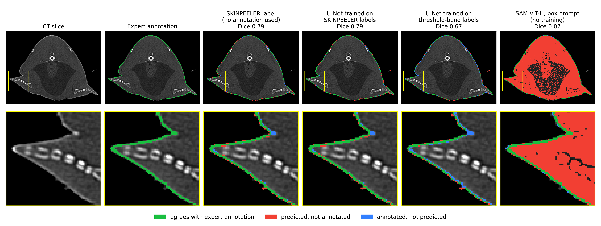

# Learned model: a U-Net trained on SKINPEELER pseudo-labels

This folder is a follow-up experiment to the SKINPEELER publication. It asks
one question: **are SKINPEELER's outputs good enough to serve as training
labels for a deep segmentation model?** A U-Net was trained using only masks
produced by the SKINPEELER engine, with no expert annotation in training,
model selection, or parameter selection, and was then scored against expert
annotation on specimens it had never seen.



*Green: agrees with expert annotation. Red: predicted but not annotated.
Blue: annotated but not predicted.*

## Result

Dice against expert annotation, air region excluded, leave-one-specimen-out
(5 specimens, 4 species, 2 CT scanners; one expert-annotated mid-body slice
per specimen).

| Training source | Model | Dice |
| --- | --- | --- |
| SKINPEELER pseudo-labels | U-Net in this folder (3 seeds) | 0.819 |
| SKINPEELER pseudo-labels | U-Net with ImageNet-pretrained ResNet34 encoder (3 seeds) | 0.821 |
| SKINPEELER pseudo-labels | U-Net with SegFormer MiT-B2 encoder | 0.815 |
| SKINPEELER pseudo-labels | nnU-Net 2d, 100 epochs | 0.801 |
| SKINPEELER pseudo-labels | MedSAM, mask decoder fine-tuned, image encoder frozen | 0.686 |
| (label generator itself) | SKINPEELER | 0.801 |
| Threshold-band labels (HU threshold body, 2-pixel inner band) | same U-Net | 0.746 |
| Expert annotation, 4 slices | same U-Net | 0.704 |
| none (zero-shot) | SAM / MedSAM / SAM 2.1 | ≤ 0.178 |

The model trained on SKINPEELER labels reaches the level of the label
generator and stays above models trained on simple threshold labels or on
the few available expert slices. Changing the encoder does not change the
score, so label quality, not architecture, sets the level. The Dice between the
trained model's predictions and SKINPEELER's masks is 0.95, and the model runs at about 6 ms per
512 × 512 slice on an RTX 3090 (SKINPEELER: about 1.1 s per slice on one CPU
process).

Rows without a seed count are single runs. With five evaluation slices,
differences of about 0.02 are within run-to-run variation.

## Model

Encoder–decoder U-Net written from scratch in PyTorch (`src/models.py`).

| Item | Value |
| --- | --- |
| Input | 1 channel, HU clipped to [-200, 800] and scaled to [0, 1] |
| Encoder | 5 stages, 32 base channels (32-64-128-256-512), two 3×3 conv + BatchNorm + ReLU per stage, 2×2 max pooling |
| Decoder | bilinear upsampling + 1×1 conv, skip connection, two 3×3 conv + BatchNorm + ReLU per stage |
| First stage | works at input resolution, so the full-resolution skip connection carries 1–3 pixel wide structures to the decoder |
| Output | 1 channel logit, sigmoid, threshold 0.5 |
| Parameters | 7.2 million |

### Training

| Item | Value |
| --- | --- |
| Labels | SKINPEELER skin masks, 2,905 slices from 5 specimens; Mahalanobis + BIC cut rule; β chosen per specimen from the whole volume without annotation |
| Split | leave-one-specimen-out; of the four training specimens one is held out for validation |
| Model selection | checkpoint with the best Dice against the validation specimen's pseudo-labels |
| Loss | binary cross-entropy + soft Dice |
| Optimizer | AdamW, learning rate 3e-4, weight decay 1e-4, OneCycleLR, mixed precision |
| Batch / epochs | 16 / 30, specimen-balanced sampling |
| Augmentation | 90° rotations, horizontal flip, small intensity scale and shift |

### Hyperparameter tuning

One fold, Dice against the validation specimen's pseudo-labels.

| Variant | Validation Dice |
| --- | --- |
| 4 stages, 32 base channels, BatchNorm, transposed convolution (starting point) | 0.917 |
| bilinear upsampling | 0.921 |
| 5 stages | 0.927 |
| **5 stages + bilinear upsampling (selected)** | **0.928** |
| 6 stages + bilinear upsampling | 0.905 |
| 64 base channels | 0.906 |
| InstanceNorm | 0.909 |
| focal + Dice loss | 0.911 |
| learning rate 1e-3 / 1e-4 | 0.907 / 0.893 |

## Weights

Five cross-validation models (seed 42) are attached to the
[`learned-model-v1` release](https://github.com/SKINPEELER-software/SKINPEELER/releases/tag/learned-model-v1).
Each one was trained without the specimen listed as held out.

| File | Held-out specimen | Dice on its expert slice |
| --- | --- | --- |
| `skinpeeler_unet_fold1.pt` | *Carcharhinus brachyurus* (CB20-0003) | 0.839 |
| `skinpeeler_unet_fold2.pt` | *Galeocerdo cuvier* (GC20-1006) | 0.742 |
| `skinpeeler_unet_fold3.pt` | *Mustelus manazo* (MM20-0006) | 0.788 |
| `skinpeeler_unet_fold4.pt` | *Carcharhinus brachyurus* (240927) | 0.898 |
| `skinpeeler_unet_fold5.pt` | *Isurus oxyrinchus* (KNU240704-4) | 0.848 |

## Usage

```bash
pip install -r requirements.txt
python predict.py <dicom_dir> <out_dir> --weights skinpeeler_unet_fold1.pt
# average several models
python predict.py <dicom_dir> <out_dir> --weights skinpeeler_unet_fold*.pt
```

`predict.py` writes one binary PNG mask per slice. `src/train.py`,
`src/losses.py` and `src/run_queue.py` are the training code as used; the CT
data are not part of this repository.

## Scope

The model was trained on shark CT (512 × 512, two scanners) and learns the
boundary-layer thickness seen there. For other specimens or imaging
conditions, generate labels with SKINPEELER for that data and train on them.

## License

MIT, same as the rest of the repository.
